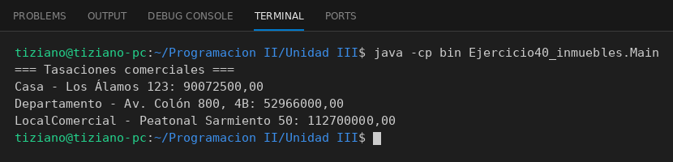

# Inmueble

Programación II - Unidad 3 - Ejercicio 40

## Consigna
Modelar una jerarquía de clases con herencia: una clase base y subclases que reutilizan código con `super` y sobrescriben métodos. Inmuebles con tasación comercial.

## Lógica
- `Inmueble` con dirección, superficie y precio base.
- `Casa`, `Departamento` y `LocalComercial` reescriben `calcularTasacion()` con los factores de cada tipo.
- `Main` imprime las tasaciones.

## Ejecución

